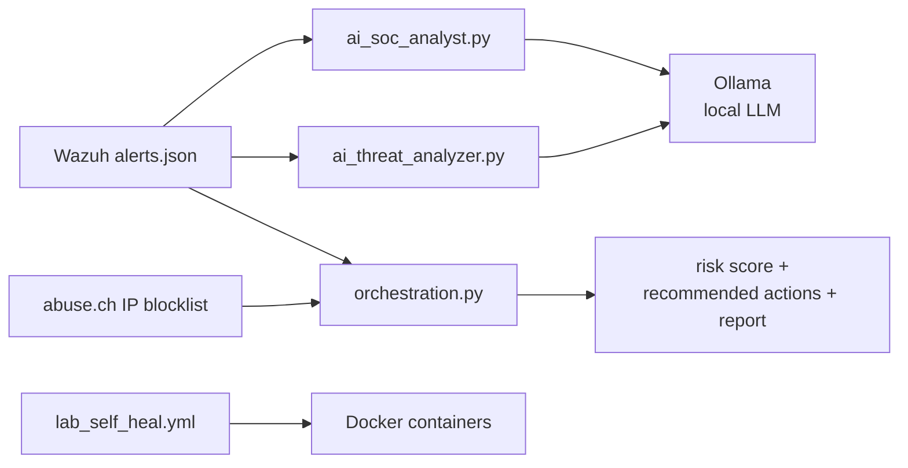

# AI SOC Orchestration

Modular Python and Ansible security automation built in a VirtualBox home lab: Wazuh alert triage with a local LLM, threat-feed correlation, and infrastructure self-healing.

## Components

| File | What it does |
|------|--------------|
| `ai_soc_analyst.py` | Follows Wazuh's `alerts.json`, picks out alerts at level 10 or higher, and sends each description to a local Llama 3.2 model (Ollama) for remediation advice. |
| `ai_threat_analyzer.py` | Reads recent Wazuh alerts and asks a local Llama 3 model for a three-sentence analysis: threat level, likely technique, recommended action. Falls back to a built-in sample alert if no alerts are found. |
| `orchestration.py` | Pulls the abuse.ch Feodo Tracker IP blocklist, parses Wazuh alerts, extracts source IPs, correlates them with the feed, checks service status with `systemctl`, computes a risk score, prints recommended response commands, and writes a report. |
| `lab_self_heal.yml` | Ansible playbook that ensures the lab's Docker containers (Nextcloud, Wiki.js, Portainer) are running and reports each one's status. |

## Flow



## Requirements

Python 3 with `requests` (`pip install -r requirements.txt`), [Ollama](https://ollama.com) with `llama3.2:1b` and `llama3`, Wazuh (for live alerts), and Ansible with the `community.general` collection (for the playbook).

## Usage

```bash
python3 orchestration.py
python3 ai_threat_analyzer.py
sudo python3 ai_soc_analyst.py     # needs read access to Wazuh's alerts file
ansible-playbook lab_self_heal.yml
```

## Results

- **Orchestration engine:** all six stages ran end to end. It loaded 5 IPs from the Feodo Tracker blocklist, found the Wazuh manager, indexer, and dashboard services up, and produced a risk score. An earlier run on real Wazuh data parsed 25 alerts with 0 threat-feed matches and a risk score of 0/100.
- **Debugging note:** the threat-feed step was silently disabled by a one-character typo (`startwith` instead of `startswith`) hidden behind a bare `except`. Adding the error message to the output exposed it.
- **AI analyzer:** with no alerts available, it analyzes a built-in sample alert (multiple failed SSH logins) so the pipeline can be tried on any machine running Ollama. The first request after starting Ollama can be slow while the model loads into memory.

## Limitations and next steps

- The "automated actions" only **recommend** commands (for example `ufw deny` and `systemctl restart`). Nothing is executed automatically.
- Alert text goes straight into the LLM prompt, so attacker-controlled log content could try to manipulate the model (prompt injection). Outputs are advice, not verified.
- Reading Wazuh's `alerts.json` requires root, and without it the scripts parse zero alerts. The path is hardcoded to the default location.
- Some `except` blocks are still broad and hide errors. Next step is proper error handling and logging.
- The Feodo Tracker list is often very short, so zero matches is a normal result.
- A notification step (for example Slack, with the webhook read from an environment variable) is a planned addition.

## Safety

Built for an isolated lab. Review any recommended command before running it.
